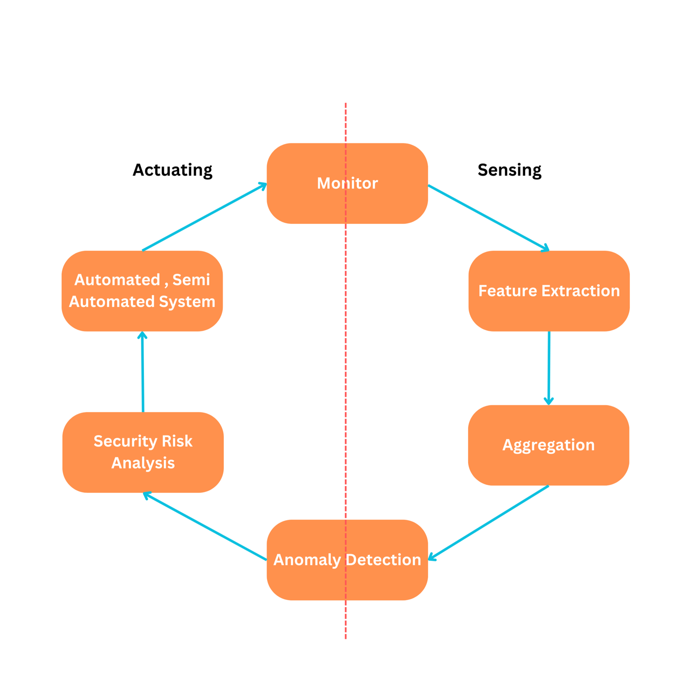
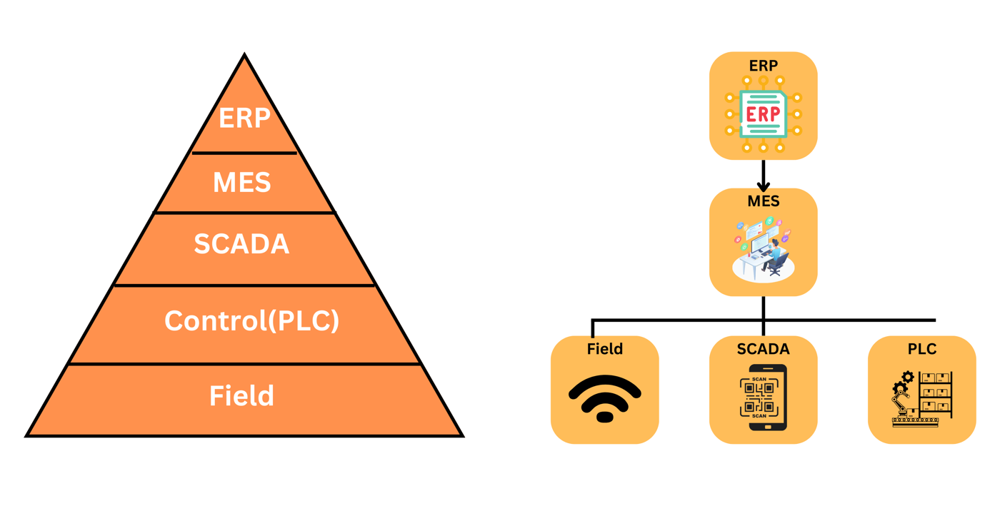
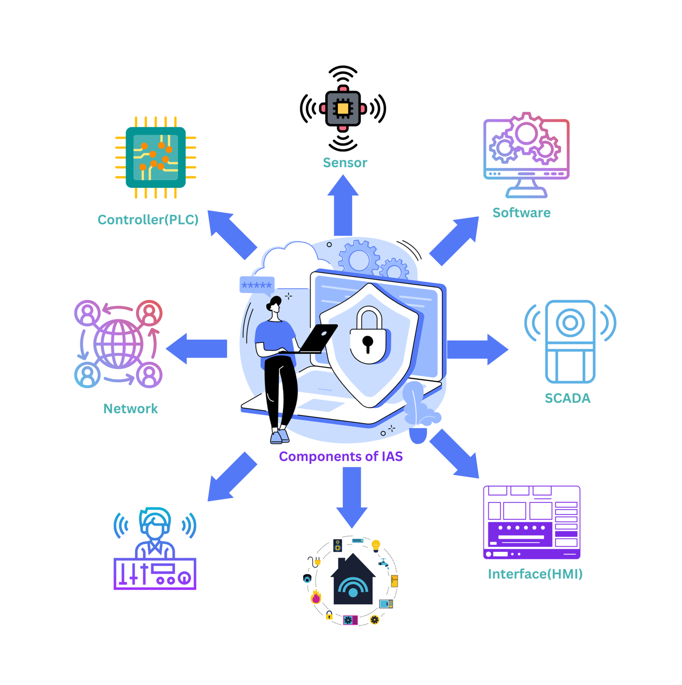
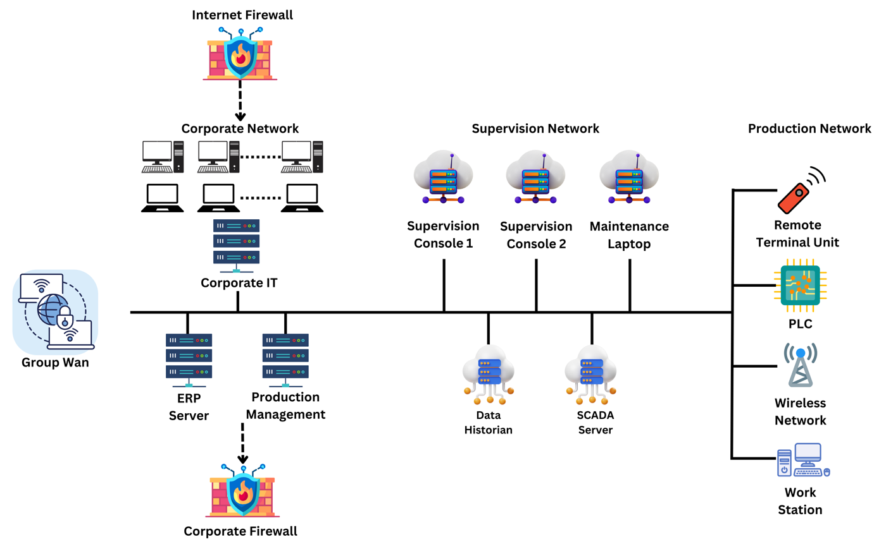
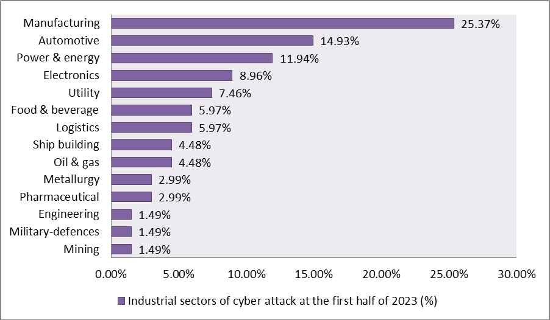
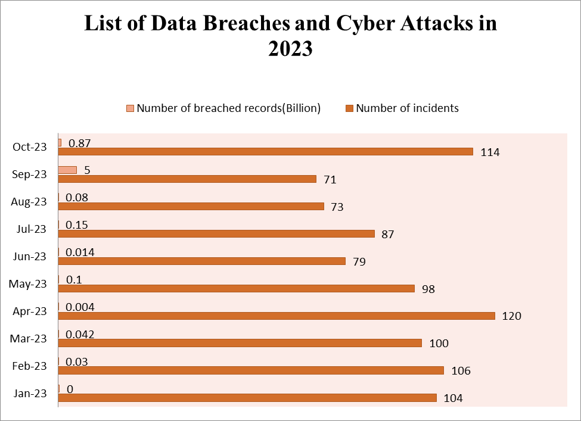
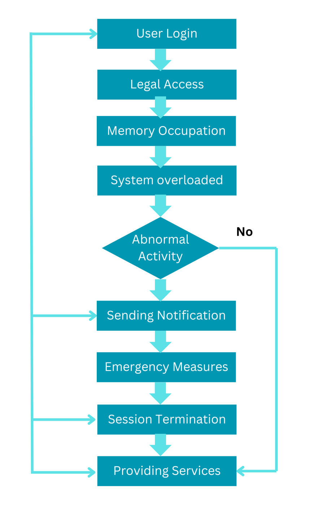

# Detecting cyberattacks in industrial automation with MPC and AI: a review

[](https://doi.org/10.1002/adc2.70003)


Industrial automation systems (PLCs, SCADA, HMIs, field networks) are now connected to corporate IT and the cloud, which makes them targets. This first-author review maps how cyberattacks on these systems are detected today, and argues for combining **model predictive control (MPC)**, which knows how the plant should behave, with **machine learning**, which learns what normal looks like.

Companion repository to the paper in *Advanced Control for Applications: Engineering and Industrial Systems* (Wiley, 2025). [Read the paper](https://doi.org/10.1002/adc2.70003)

## The core idea in one picture

<p align="center"></p>

Sense, extract features, aggregate, detect anomalies, analyse the risk, act, and keep monitoring. MPC supplies the physics-based prediction; AI supplies the learned picture of normal behaviour. A gap between what the controller predicted and what the sensors report is the alarm.

## What the review covers

| Section | What it gives you |
|---|---|
| Real-time attack sources | Why signature-based intrusion detection misses novel attacks, and how ML-based anomaly detection fills the gap |
| IAS security overview | Threats (phishing, malware), ML for cybersecurity, standards and best practice, known ICS vulnerabilities |
| Industrial automation systems | The layers from field devices to ERP, their functions, and where each layer is exposed |
| Recent incidents | 2023 attack statistics by industrial sector and month |
| MPC for attack mitigation | Seven MPC families compared, MPC for detection and for mitigation, published case studies |
| Problem formulation | An MPC-based attack-detection formulation for networked cyber-physical systems |
| Limitations and future work | Scalability, uncertainty, compute cost; ML-in-the-loop MPC, edge and cloud MPC, resilient-by-design controllers |

## Where industrial systems are exposed

| The automation stack | Components an attacker can reach |
|---|---|
|  |  |

<p align="center"><br>
<em>Security devices across the corporate, supervision and production networks.</em></p>

## The threat is growing

| Attacked industrial sectors, H1 2023 | Breaches and incidents per month, 2023 |
|---|---|
|  |  |

Manufacturing was the most attacked sector (about 25% of cases), followed by automotive and power. Chart data: [Kaspersky ICS CERT, H1 2023 report](https://ics-cert.kaspersky.com/publications/reports/2023/10/05/h1-2023-a-brief-overview-of-main-incidents-in-industrial-cybersecurity/) and [IT Governance, list of 2023 breaches](https://www.itgovernance.co.uk/blog/list-of-data-breaches-and-cyber-attacks-in-2023).

## How MPC detects and resists attacks

**Detection.** MPC runs a model of the plant to predict the next states. Under attack, measurements stop matching predictions. That prediction error is the detection signal; a statistical test or an ML classifier decides whether it is abnormal.

**Two attack families** the formulation covers:

| Family | Examples | What happens to a signal $g(k)$ (state or input) |
|---|---|---|
| Deception | False-data injection, replay, stealth attacks | Attacker adds data: $g_{\text{att}}(k) = g(k) + \gamma(k)\,a_g(k)$, with $\gamma(k) \in \lbrace 0, 1 \rbrace$ |
| Disruption | Denial of service, jamming | Signal is blocked: $g_{\text{att}}(k) = v(k)\,g(k)$, with $v(k) = 0$ during the attack |

**Plant and controller.** Each subsystem follows a linear model with coupling to its neighbours, $x_i(k+1) = A_{ii}x_i(k) + B_{ii}u_i(k) + w_i(k)$. The distributed MPC minimises

$$J(\mathbf{x}, \mathbf{u}) = \sum_{i} \sum_{n=0}^{N_h - 1} \lVert x_i(n) - x_{\text{ref},i} \rVert_{Q_i}^2 + \lVert u_i(n) \rVert_{R_i}^2$$

over a prediction horizon $N_h$.

**Mitigation.** Once an attack is flagged, robust MPC keeps control with a safety margin, and distributed MPC coordinates the remaining healthy controllers.

The paper illustrates this with the four-tank distributed-MPC benchmark from [Arauz, Chanfreut and Maestre (2022)](https://doi.org/10.1016/j.arcontrol.2021.10.005), comparing normal operation with a DoS attack.

### MPC families compared

| Algorithm | Strength for security | Limitation |
|---|---|---|
| Standard MPC | Simple; works for predictable dynamics | Weak against model error and disturbances |
| Robust MPC | Stays stable under model uncertainty | Higher computational cost |
| Distributed MPC | Scales to large interconnected plants | Needs reliable communication between controllers |
| Economic MPC | Optimises cost and security together | Hard to balance economic and control goals |
| Adaptive MPC | Updates its model from live data | Expensive; model updates must be robust |
| Learning-based MPC | Learns behaviour from historical data | Needs large datasets; learned models can err |
| Stochastic MPC | Probabilistic safety guarantees | Needs accurate uncertainty distributions |

## Securing the human side

<p align="center"></p>

Login, access rights, memory and load checks feed an abnormal-activity test. Abnormal sessions trigger notification, emergency measures and termination.

## Open problems

- MPC cost grows fast with plant size, which strains real-time protection of large networks.
- Model uncertainty can make MPC over-conservative or blind to subtle attacks.
- ML detectors need high-quality labelled industrial data, which is scarce.
- Next steps: ML anomaly detection inside the MPC loop, edge and cloud split for heavy optimisation, and controllers designed to stay stable under attack.

## Citation

Rahman, M.M., Mahmud, J.A. and Ali, M.F. (2025). A Review on Detection of Cyberattacks in Industrial Automation Systems and Its Advancement Through MPC-Based AI. *Advanced Control for Applications: Engineering and Industrial Systems*, 7, e70003. https://doi.org/10.1002/adc2.70003

```bibtex
@article{rahman2025review,
  author  = {Rahman, Md. Musfiqur and Mahmud, Jubayer Al and Ali, Md. Firoj},
  title   = {A Review on Detection of Cyberattacks in Industrial Automation Systems and Its Advancement Through {MPC}-Based {AI}},
  journal = {Advanced Control for Applications: Engineering and Industrial Systems},
  volume  = {7},
  pages   = {e70003},
  year    = {2025},
  doi     = {10.1002/adc2.70003}
}
```

## Rights

Figures and tables are reproduced from the article with full credit: Rahman, Mahmud and Ali, *Advanced Control for Applications: Engineering and Industrial Systems* 7 (2025) e70003, https://doi.org/10.1002/adc2.70003, © 2025 [copyright owner as printed on the article]. Reused by the authors without modification, for non-commercial purposes. The two statistics charts redraw data from the sources named under them. The published article itself is not redistributed here.

## Author

**Md. Musfiqur Rahman** (first author), Department of Mechatronics Engineering, Rajshahi University of Engineering & Technology (RUET). musfiqurtonmoy@gmail.com · [GitHub](https://github.com/musfiqurtonmoy)
